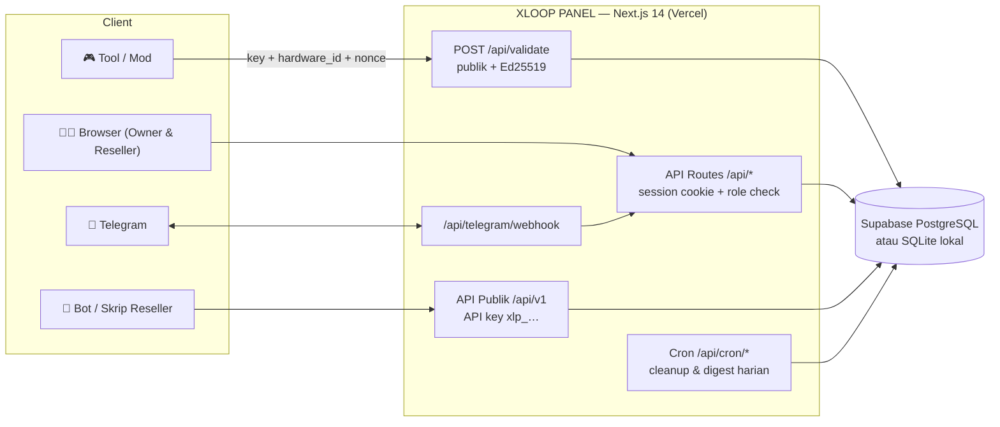
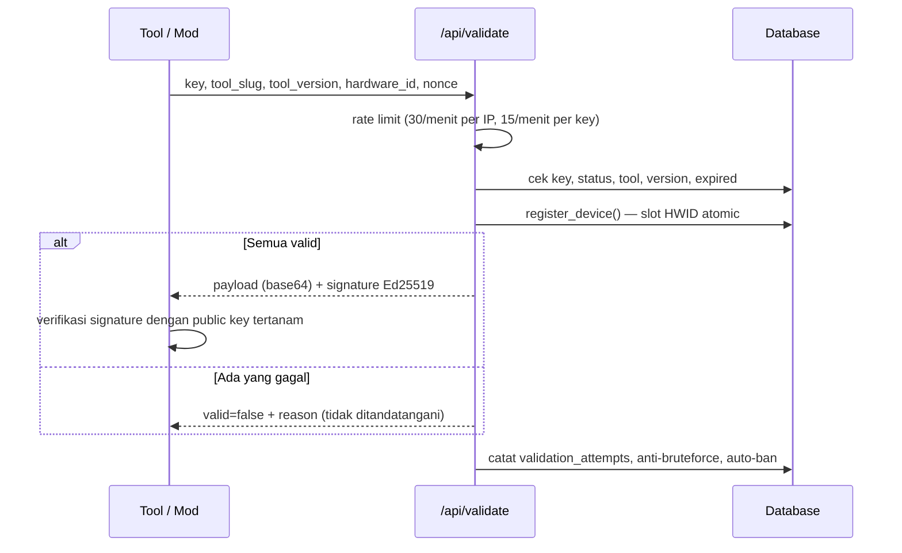

<p align="center">
  
</p>

<h1 align="center">XLOOP PANEL</h1>

<p align="center">
  <strong>Panel manajemen lisensi key full-stack dengan validasi <em>anti-bypass</em> —<br>
  response sukses ditandatangani Ed25519 dan terikat ke <code>nonce</code> + <code>hardware_id</code>.</strong>
</p>

<p align="center">
  
  
  
  
  
  
  
  
  
</p>

<p align="center">
  <a href="#-quick-start">⚡ Quick Start</a> •
  <a href="#-fitur">✨ Fitur</a> •
  <a href="#-struktur-folder">📁 Struktur</a> •
  <a href="#-referensi-api">📚 API</a> •
  <a href="docs/CLIENT_INTEGRATION.md">🔌 Integrasi Client</a> •
  <a href="docs/RESELLER_API.md">🤖 Reseller API</a>
</p>

---

## 📖 Tentang

**XLOOP PANEL** adalah panel administrasi lisensi untuk tool/mod: kelola **tool type & version**,
**preset durasi**, **generate key** (`XLVP-XXXX-XXXX`), **reseller**, **credit**, sampai endpoint
validasi publik `/api/validate` yang keputusannya sepenuhnya di server dan response-nya
**ditandatangani digital (Ed25519)** — client tidak pernah dipercaya.

Panel ini punya **dua role** (Owner & Reseller) dengan sistem credit, **dua mode database**
(Supabase untuk produksi, SQLite lokal tanpa setup untuk development/demo), **bot Telegram**,
**API publik `/api/v1`** untuk otomasi reseller, serta lapisan anti-abuse lengkap:
rate limit, anti-bruteforce, auto-ban multi-device, cooldown reset HWID, audit log, dan
analitik percobaan validasi.

**Highlight:**

| | |
|---|---|
| 🔏 **Anti-bypass** | Response validasi sukses ditandatangani Ed25519, terikat `nonce` + `hardware_id`, TTL 15 menit. Response gagal tidak pernah ditandatangani |
| 🗄 **Dua mode database** | Supabase (Postgres + Auth + RLS) atau SQLite lokal — satu codebase, adapter transparan di `lib/db/sqlite` |
| 💳 **Ekosistem credit** | Generate/perpanjang memotong credit reseller (`harga × quantity × max device`), refund otomatis saat Owner menghapus key aktif, semua tercatat di Credit Log |
| 🤖 **Bot & notifikasi Telegram** | Auto-ban, brute-force, saldo tipis, ringkasan harian ke Owner; reseller bisa generate key & reset HWID langsung dari chat Telegram |
| 🔑 **API publik `/api/v1`** | API key `xlp_…` (disimpan sebagai hash SHA-256, tampil sekali) untuk bot/skrip reseller |
| 🧾 **Audit & analitik** | Audit log terpadu (aksi key + aktivitas akun/sistem dalam satu timeline), analitik percobaan validasi, export CSV di mana-mana |
| 🎨 **UI cepat & ringan** | Dark-only, tema bisa dikustom penuh, command palette (Ctrl/⌘ K), tanpa library animasi berat — ramah HP kelas menengah |

---

## 🧭 Cara Kerja



Alur endpoint validasi (`POST /api/validate`):



---

## ⚡ Quick Start

Tidak perlu Supabase, tidak perlu env apa pun — panel langsung jalan dengan database SQLite lokal:

```bash
git clone https://github.com/axellpemula/Panel-Admin.git
cd Panel-Admin
npm install        # Node.js 20.x
npm run demo       # http://localhost:3010
```

Login dengan akun contoh yang sudah di-seed:

| Role | Email | Password | Keterangan |
|---|---|---|---|
| **Owner** | `owner@gmail.com` | `Axell123` | Akses penuh semua menu |
| Reseller | `andi@example.com` | `Reseller123` | Key & credit miliknya sendiri |
| Reseller | `budi@example.com` | `Reseller123` | — |
| Reseller | `citra@example.com` | `Reseller123` | Sengaja **nonaktif** (untuk menguji alur "Akun kamu dinonaktifkan") |

> ⚠️ Ganti password setelah login pertama: **Pengaturan → Keamanan Akun → Ganti password**.
> Mode demo memakai file `data/xloop.sqlite` (di-gitignore). Reset kapan saja: `npm run db:reset`.

Ingin langsung pakai Supabase? Lihat [Setup produksi](#-setup-produksi-supabase).

---

## ✨ Fitur

### 👑 Role: Owner

| Menu | Isi |
|---|---|
| **Dashboard** | Total key (all/active/expired/banned), reseller aktif, key dibuat hari ini & minggu ini, grafik 7 hari, top 5 reseller, 10 aktivitas terakhir |
| **Tool Management** | CRUD tool type + version, toggle aktif, payload rahasia per tool (`tool_secrets` — tidak pernah dikirim balik ke browser), kotak public key verifikasi |
| **Duration Setting** | CRUD preset durasi (nama, hari, harga credit, aktif/nonaktif) |
| **Key List** | Semua key + filter (status/tool/version/reseller), sort, pagination, detail & manajemen HWID, edit (perpanjang preset / tambah hari / set tanggal / lifetime — bebas biaya), ban dengan **alasan terstruktur** (`manual` / `refund` / `other` + catatan), unban, hapus (key reseller aktif & belum expired → **credit dikembalikan otomatis**) |
| **Generate Key** | Preset **atau** durasi custom tanpa potongan credit, 1–100 key sekaligus, copy semua, export `.txt` |
| **Reseller** | Tambah reseller (set password langsung), topup, aktif/nonaktif, reset password, edit, hapus permanen. Halaman detail `/resellers/[id]`: statistik, grafik 7 hari, key terbaru, riwayat credit, riwayat login, **penyesuaian credit** (tambah/kurangi dengan alasan wajib) |
| **Credit Log** | Semua transaksi credit (topup, generate, extend, refund, adjustment), filter tanggal/aksi/reseller, export CSV |
| **Audit Log** | **Satu timeline terpadu**: jejak aksi key (ban/unban/hapus/reset HWID/auto-ban — oleh Owner, Reseller, atau sistem, lengkap dengan alasan & catatan) digabung aktivitas akun & sistem (ganti password, putus sesi, API key, pengaturan, credit, Telegram). Filter + export CSV. **Unban auto-ban hanya bisa oleh Owner** |
| **Validation Attempts** | Analitik anti-abuse `/api/validate`: ringkasan sukses/gagal, IP mencurigakan, key paling sering gagal (breakdown alasan), tren per jam, daftar percobaan + filter + export CSV. Retensi 7 hari |
| **Pengaturan** | Info Akun, Info Web, Keamanan Akun (ganti password + sesi aktif + putus sesi lain), Riwayat Login, Kepadatan Tabel, Tema Warna, Integrasi **Telegram** & **API Key**, dan kartu **Batas & Sistem** (semua ambang runtime: rate limit, brute-force, auto-ban, TTL token, kuota HWID, retensi log, saklar API publik, notifikasi — nilai di luar rentang dijepit otomatis) |

### 🧑‍💼 Role: Reseller

| Menu | Isi |
|---|---|
| **Dashboard** | Statistik key miliknya sendiri, sisa credit, key hari ini, grafik 7 hari, aktivitas sendiri |
| **Key List** | Hanya key miliknya: detail + reset HWID (dengan **cooldown 3×/24 jam per key**), edit — perpanjang **wajib** pakai preset Owner dan memotong credit (`harga preset × max device`), ban dengan alasan terstruktur, hapus. Tidak bisa unban auto-ban |
| **Generate Key** | Preset durasi saja, biaya `harga preset × quantity × max device` dipotong otomatis, 1–50 key sekaligus |
| **Credit Log** | Riwayat credit miliknya, export CSV |
| **Pengaturan** | Info akun + sisa credit, ganti password & sesi aktif, riwayat login, tema, kepadatan tabel, integrasi **Telegram** & **API key** miliknya |

### 🔌 Endpoint publik & mesin

| Endpoint | Fungsi |
|---|---|
| `POST /api/validate` | Validasi key dari sisi tool/mod — response sukses **ditandatangani Ed25519** + membawa `secret_payload` tool. Docs: [`CLIENT_INTEGRATION.md`](docs/CLIENT_INTEGRATION.md) |
| `GET/POST /api/v1/...` | API publik reseller dengan API key `xlp_…` — generate key, cek saldo, kelola key, reset HWID dari bot/skrip. Docs: [`RESELLER_API.md`](docs/RESELLER_API.md) |
| `GET /api/cron/cleanup` | Dipanggil Vercel Cron (03:00 UTC): hapus log kedaluwarsa sesuai retensi + `update_expired_keys()` |
| `GET /api/cron/digest` | Ringkasan harian 24 jam terakhir ke Telegram/webhook Owner (01:00 UTC) |
| `POST /api/telegram/webhook` | Penerima update bot Telegram (wajib header `X-Telegram-Bot-Api-Secret-Token`) |

### 💳 Aturan biaya credit

**1 unit harga = 1 key × 1 device** — menambah `max device` sama seperti menambah `quantity`.

| Aksi | Biaya (Reseller) | Biaya (Owner) |
|---|---|---|
| Generate key | `harga preset × quantity × max device` | gratis |
| Perpanjang key (pakai preset) | `harga preset × max device` — semua device terdaftar ikut diperpanjang | gratis |
| Menambah `max device` | wajib memilih preset (device baru = unit baru), biaya ikut perpanjangan | gratis |
| Mengubah catatan / mengurangi `max device` | gratis | gratis |

**Refund saat key dihapus.** Kalau Owner menghapus key milik reseller yang **masih `active` dan
belum expired**, seluruh `credit_cost` key itu dikembalikan (tercatat sebagai aksi `refund` di
Credit Log). Key expired/banned atau key milik sendiri → tidak ada refund. Menghapus **akun**
reseller tidak memicu refund. Dialog konfirmasi selalu menjelaskan situasinya sebelum eksekusi.

Aturan lain untuk Reseller: durasi hanya dari preset Owner (`extend`/`set`/`lifetime` ditolak
`403`), saldo tidak cukup → `402 insufficient_credit` tanpa perubahan apa pun (atomic — kalau
pemotongan gagal di tengah, perubahan key di-rollback), dan setiap potongan tercatat di Credit Log.

### 💬 Telegram

- **Notifikasi ke Owner**: key auto-ban, login reseller gagal berulang, brute-force validasi per IP,
  saldo reseller melewati ambang tipis, plus **ringkasan harian** via cron. Bisa juga diteruskan ke
  webhook HTTP sendiri (`XLOOP_NOTIFY_WEBHOOK_URL`).
- **Notifikasi personal ke Reseller** (setelah menautkan chat): key diblokir/di-unban/dihapus
  (+refund), credit masuk/penyesuaian, pengingat harian key expiring ≤ 3 hari.
- **Bot interaktif**: menu tombol (`/menu`) atau perintah teks — `/saldo`, `/preset`, `/keys`
  (pagination), `/key`, `/generate` (wizard tool → version → preset → jumlah → device + konfirmasi
  biaya), `/reset` HWID, `/unlink`.
- Semua jenis notifikasi bisa dimatikan dari **Pengaturan → Batas & Sistem → Notifikasi**.

### 🎨 Pengalaman panel

- **Sidebar bisa disembunyikan** (klik logo X 3D) — preferensi di cookie `xloop_sidebar`, dibaca di
  server sehingga tidak berkedip saat halaman dimuat.
- **Tema warna penuh**: 8 preset aksen / hex custom, 7 palet gelap (Hangat, Grafit, Midnight, Hitam
  pekat, Ocean, Forest, Plum), 6 warna permukaan custom, pilihan radius (Tajam/Standar/Membulat),
  dengan peringatan kontras WCAG AA. Disimpan di cookie `xloop_theme` (1 tahun), diterapkan via
  CSS variable di `<html>` — benar sejak HTML pertama.
- **Command palette** (Ctrl/⌘ K): lompat ke menu sesuai role, aksi cepat, dan **cari key** — ketik
  potongan `XLVP-…`, Enter membuka Key List dengan filter terisi.
- **Key List responsif**: kolom *Last used* relatif, penanda "Segera expired" (≤ 3 hari), berubah
  jadi daftar kartu di layar HP; kepadatan baris (Nyaman 44px / Kompak 36px) diatur dari Pengaturan.
- **Loading splash interaktif** setelah login (orbit berputar, partikel, progress bar nyata) dan
  **skeleton shimmer** yang hidup — semua murni CSS/transisi 150–200 ms, menghormati
  `prefers-reduced-motion`. Tanpa Three.js/WebGL/Lottie — sengaja ringan untuk HP kelas menengah.
- **Riwayat login & sesi**: setiap percobaan login (sukses/gagal) dicatat dengan IP & user-agent;
  daftar sesi aktif per perangkat dengan tombol "putus semua sesi lain".

### 🛡 Batas anti-abuse (bawaan)

| Proteksi | Nilai default |
|---|---|
| Rate limit `/api/validate` | 30 request/menit per IP · 15/menit per key (dihitung dari database — aman untuk serverless) |
| Anti-bruteforce validasi | 5× `invalid_key` per IP dalam 10 menit → semua kegagalan berikutnya disamarkan jadi `invalid_key` |
| Auto-ban multi-device | 1 key ditolak `device_limit_exceeded` oleh 5 HWID berbeda dalam 1 jam → banned otomatis (`ban_reason = auto_hwid`), **unban hanya oleh Owner** |
| Cooldown reset HWID | Reseller maks 3× reset per key per 24 jam (rolling). Owner tidak terkena batas dan reset-nya tidak memakan kuota reseller. Server membalas `429` + `Retry-After`, UI menampilkan hitung mundur live |
| Brute-force login | 10 percobaan gagal per IP per 10 menit |
| Format key | `XLVP-XXXX-XXXX`, alpabet tanpa karakter ambigu (0/O, 1/I), dibuat dengan `crypto.randomInt` (CSPRNG) + cek duplikat |

Semua ambang di atas **bisa diubah Owner** dari Pengaturan → Batas & Sistem (dijepit ke rentang aman).

---

## 🛠 Tech Stack

| Layer | Teknologi |
|---|---|
| Frontend & Backend | **Next.js `14.2.15`** (App Router + API Routes) |
| Bahasa | **TypeScript 5** (strict, `npm run typecheck`) |
| Database & Auth | **Supabase** (PostgreSQL + Supabase Auth + RLS) atau **SQLite** lokal (`better-sqlite3`) |
| Supabase client | `@supabase/ssr@0.5.2` + `@supabase/supabase-js@2.45.4` |
| Styling | **Tailwind CSS 3.4** (dark only, token warna di `app/globals.css`) |
| Ikon & Chart | `lucide-react` (stroke 1.5) · `recharts` (dynamic import, `ssr: false`) |
| Font | Geist Sans + Geist Mono via `next/font` |
| Signing | **Ed25519** (WebCrypto/Node crypto — tanpa dependency tambahan) |
| Runtime | Node.js **20.x LTS** |
| Deploy | **Vercel** (region `sin1`) + Vercel Cron |

> **Kenapa versi Supabase di-pin?** `@supabase/supabase-js` versi 2.11x+ mensyaratkan Node 22
> (WebSocket bawaan). Kombinasi di atas stabil untuk Node 20 LTS. Naik ke Node 22? Bump keduanya
> bersamaan: `npm i @supabase/ssr@latest @supabase/supabase-js@latest`.

### Pemilihan mode database

`lib/env.ts` → `dbMode()` menentukan mode dengan urutan:

1. `XLOOP_DB=supabase|sqlite` → paksa salah satu (paling eksplisit);
2. `NEXT_PUBLIC_MOCK_MODE=1` → SQLite (flag lama, tetap didukung);
3. Env Supabase (`URL` + `ANON_KEY` + `SERVICE_ROLE_KEY`) belum lengkap → **otomatis SQLite**;
4. Selain itu → Supabase.

Di mode SQLite, `lib/db/sqlite/adapter.ts` menyediakan permukaan API yang identik dengan
`supabase-js` (`from().select().eq()…`, `rpc()`, `auth.admin.createUser()`), jadi seluruh API route
dan endpoint validasi **tidak ditulis dua kali**. Skema, fungsi RPC, dan index adalah cerminan
`migration.sql` dalam dialek SQLite. Detail: [Mode SQLite](#-mode-sqlite-lokal--pratinjau).

### Logo & identitas

Logo panel adalah huruf **"X" 3D** sebagai SVG custom (inline, tanpa background):

| Berkas | Isi |
|---|---|
| `components/ui/XloopMark.tsx` | Komponen logo (sidebar 28px, login 32px) — warna mengikuti token `--c-accent` |
| `public/xloop-mark.svg` | Versi standalone (warna harfiah) untuk README / materi promosi |
| `app/icon.svg` | Favicon: logo yang sama di atas rounded square |

Digambar sebagai satu path 12 titik yang dirender **tiga kali** dengan offset diagonal 0.5/1px dan
tone makin gelap — terbaca 3D tanpa gradient, glow, filter, atau shadow.

---

## 📁 Struktur Folder

```
root/
├── app/
│   ├── (auth)/login/              # halaman login (satu-satunya halaman publik)
│   ├── (dashboard)/               # semua halaman panel (butuh sesi)
│   │   ├── layout.tsx             # shell: cookie sidebar + sidebar/topbar + konten
│   │   ├── dashboard/             # overview Owner & Reseller (+ skeleton loading.tsx)
│   │   ├── tools/                 # Tool Management (Owner)
│   │   ├── durations/             # Duration Setting (Owner)
│   │   ├── keys/                  # Key List
│   │   ├── generate/              # Generate Key
│   │   ├── resellers/             # Reseller (Owner) + [id]/ detail reseller
│   │   ├── credits/               # Credit Log
│   │   ├── audit/                 # Audit Log terpadu (Owner)
│   │   ├── validation-attempts/   # analitik anti-abuse (Owner)
│   │   └── settings/              # akun, keamanan, tema, Telegram, API key, batas sistem
│   ├── api/                       # 23+ API routes — lihat Referensi API
│   │   ├── auth/                  # login, logout, session, password, sessions, logins
│   │   ├── keys/                  # list, generate, edit, ban/unban, devices (HWID)
│   │   ├── tools/ durations/      # CRUD tool, version, secret payload, preset durasi
│   │   ├── resellers/ credits/    # manajemen reseller + credit log
│   │   ├── audit/ validation-attempts/ settings/
│   │   ├── telegram/ api-keys/    # penautan chat + webhook bot + API key xlp_…
│   │   ├── v1/                    # API publik reseller (docs/RESELLER_API.md)
│   │   ├── validate/              # endpoint publik validasi (Ed25519)
│   │   └── cron/                  # cleanup & digest (Bearer CRON_SECRET)
│   ├── globals.css                # token warna + base style
│   ├── icon.svg                   # favicon (logo X 3D)
│   └── layout.tsx                 # root layout (font Geist, ToastProvider)
├── components/
│   ├── dashboard/                 # KeyTable, HwidModal, KeyEditModal, StatCard, chart, views per menu
│   ├── ui/                        # Button, Modal, Select, Badge, Toast, Skeleton, Form, CopyButton,
│   │                              # EmptyState, Pagination, XloopMark (logo)
│   └── layout/                    # DashboardShell, Sidebar (+toggle), Topbar, CommandPalette, nav.ts
├── lib/
│   ├── api/                       # helper server: auth context, keys, stats, generate, settings
│   │                              # runtime, notify (Telegram/webhook), api-keys, v1, telegram-bot
│   ├── db/sqlite/                 # mode SQLite: schema, seed, adapter supabase-like, auth, rpc, password
│   ├── supabase/                  # server, admin (service role), middleware — pintu ke DB aktif
│   ├── types/                     # tipe Database + tipe UI
│   ├── utils/                     # crypto (Ed25519 + generator key), format, csv, http, validate,
│   │                              # pricing, refund, telegram (Bot API), json, cookie, cn, user-agent
│   ├── env.ts                     # pemilih mode database (Supabase ⇄ SQLite)
│   ├── constants.ts               # format key, limit, rate limit, cooldown HWID
│   ├── theme.ts · density.ts      # preferensi tema & kepadatan tabel (cookie, dibaca di server)
├── docs/
│   ├── CLIENT_INTEGRATION.md      # cara menanam verifikasi di sisi tool/mod
│   ├── RESELLER_API.md            # dokumentasi API publik /api/v1
│   ├── VERIFICATION.md            # hasil pengujian (verify:*) & checklist produksi
│   └── examples/                  # verifier contoh Python & JS + sample response + public key contoh
├── scripts/
│   ├── generate-keypair.mjs       # generate keypair Ed25519 (opsi --write ke .env.local)
│   └── make-sample-response.mjs   # sample response bertanda tangan untuk uji verifier
├── dev/
│   ├── local-server.mjs           # jalankan panel mode SQLite (npm run demo)
│   ├── sqlite-cli.mjs             # utilitas DB: info | accounts | reset
│   ├── sqlite-e2e-test.mjs        # e2e panel mode SQLite (90 pemeriksaan)
│   ├── validate-e2e-test.mjs      # e2e endpoint validasi (28 pemeriksaan)
│   ├── features-e2e-test.mjs      # e2e fitur akun/notifikasi/API key/bot Telegram (94 pemeriksaan)
│   ├── focus-test.mjs             # uji fokus input (regresi keyboard mobile)
│   └── sidebar-test.mjs           # uji toggle sidebar (44 pemeriksaan)
├── data/                          # database SQLite (dibuat otomatis, di-gitignore)
├── public/xloop-mark.svg          # logo standalone
├── migration.sql                  # SQL idempotent siap run di Supabase SQL Editor
├── middleware.ts                  # proteksi halaman + refresh sesi (API routes cek sesi sendiri)
├── vercel.json                    # region sin1 + jadwal cron (cleanup 03:00, digest 01:00 UTC)
├── .env.example                   # daftar environment variables
└── package.json
```

---

## 🏗 Setup Produksi (Supabase)

### 1. Buat project

1. [supabase.com/dashboard](https://supabase.com/dashboard) → **New project**.
2. Isi nama, password database, pilih region terdekat (mis. *Southeast Asia – Singapore*).

### 2. Jalankan migration

Buka **SQL Editor → New query**, paste seluruh isi [`migration.sql`](migration.sql), lalu **Run**
(harus muncul `Success. No rows returned`). File-nya **idempotent** — aman dijalankan ulang, berisi:

- **Tabel**: `profiles`, `tool_types`, `tool_versions`, `duration_presets`, `keys`, `device_logs`,
  `credit_logs`, `tool_secrets`, `validation_attempts`, `audit_logs`, `login_logs`, `activity_logs`,
  `app_settings`, `reseller_api_keys`, `api_request_logs`, `telegram_links`, `telegram_link_codes`,
  `notification_logs`
- **Fungsi (RPC)**: `register_device` (slot HWID atomic), `spend_credit`, `add_credit`,
  `update_expired_keys`, `cleanup_validation_attempts`, `check_auto_ban` (dengan advisory lock),
  `key_device_counts`, `key_counts_by_version`, `reseller_summary`, `is_owner`, `update_updated_at`
- **RLS + policy** semua tabel, index performa, trigger `updated_at`

> `tool_secrets` dan `validation_attempts` sengaja **tanpa policy** — hanya `service_role`
> (API routes) yang bisa mengaksesnya.

### 3. Ambil kredensial

**Project Settings → API**:

| Yang diambil | Untuk env |
|---|---|
| Project URL | `NEXT_PUBLIC_SUPABASE_URL` |
| `anon` `public` key | `NEXT_PUBLIC_SUPABASE_ANON_KEY` |
| `service_role` `secret` key | `SUPABASE_SERVICE_ROLE_KEY` (**server only!**) |

### 4. Buat akun Owner pertama

`migration.sql` **tidak** membuat akun — buat sendiri sekali:

1. Supabase Dashboard → **Authentication → Users → Add user** (centang *Auto Confirm User*).
2. Jalankan di SQL Editor supaya user itu jadi Owner:

   ```sql
   INSERT INTO profiles (id, username, email, role, credit, is_active)
   VALUES ('<uuid-user-dari-auth.users>', 'owner', 'email@kamu.com', 'owner', 0, true)
   ON CONFLICT (id) DO UPDATE SET role = 'owner';
   ```

Setelah login pertama: buat tool di **Tool Management**, atur preset di **Duration Setting**, isi
**payload rahasia** tool, lalu tambah reseller di **Reseller → Tambah Reseller**.

---

## 🔧 Environment Variables

Copy [`.env.example`](.env.example) menjadi `.env.local` untuk lokal, dan isi variable yang sama di
**Vercel → Settings → Environment Variables** untuk produksi.

| Variable | Wajib | Keterangan |
|---|---|---|
| `NEXT_PUBLIC_SUPABASE_URL` | ✅\* | Project URL Supabase |
| `NEXT_PUBLIC_SUPABASE_ANON_KEY` | ✅\* | Anon key (aman di browser, dibatasi RLS) |
| `SUPABASE_SERVICE_ROLE_KEY` | ✅\* | Service role key — **server only**, tanpa prefix `NEXT_PUBLIC_`, jangan di-commit |
| `LICENSE_SIGNING_PRIVATE_KEY` | ✅ | Private key Ed25519 (PKCS8 PEM → base64 satu baris) untuk menandatangani `/api/validate` |
| `LICENSE_SIGNING_PUBLIC_KEY` | ✅ | Public key Ed25519 (SPKI PEM → base64) — ditanam di tool; tampil juga di Tool Management |
| `CRON_SECRET` | ✅ | Bearer token untuk `/api/cron/cleanup` & `/api/cron/digest` |
| `LICENSE_TOKEN_TTL_SECONDS` | ➖ | TTL token validasi. Default `900` (15 menit) |
| `XLOOP_DB` | ➖ | Paksa mode `supabase` \| `sqlite`. Kosong = otomatis |
| `XLOOP_SQLITE_PATH` | ➖ | Lokasi file SQLite. Default `data/xloop.sqlite` |
| `NEXT_PUBLIC_MOCK_MODE` | ➖ | `1` = paksa SQLite (flag lama). Jangan di production |
| `XLOOP_NOTIFY_WEBHOOK_URL` | ➖ | Webhook HTTP penerus notifikasi (gagal kirim tidak menggagalkan aksi utama) |

\* Wajib **hanya kalau memakai Supabase**. Kalau salah satu kosong, panel otomatis jalan di mode
SQLite — tidak ada lagi panel yang gagal terbuka karena "env belum diisi".

**Aturan penting:** private key, service role key, dan `CRON_SECRET` tidak boleh ber-prefix
`NEXT_PUBLIC_`; private key, `secret_payload`, dan service role key tidak pernah ditulis ke log.

---

## 🔑 Keypair Ed25519

```bash
npm run generate-keypair
# atau langsung tulis ke .env.local (nilai lama tidak ditimpa):
node scripts/generate-keypair.mjs --write
```

Output-nya dua baris base64 siap tempel:

```
LICENSE_SIGNING_PRIVATE_KEY=LS0tLS1CRUdJTiBQUklWQVRFIEtFWS0t…
LICENSE_SIGNING_PUBLIC_KEY=LS0tLS1CRUdJTiBQVUJMSUMgS0VZLS0t…
```

- **Private key** → env server saja (Vercel env; bukan `NEXT_PUBLIC_*`).
- **Public key** → tempel di tool/mod kamu, atau salin dari panel: **Tool Management → kotak
  "Public key verifikasi" → copy**.
- **Private key bocor?** Generate keypair baru, update env server, lalu distribusikan public key
  baru ke semua client — signature lama otomatis tidak valid (itu memang tujuannya).

---

## ▲ Deploy ke Vercel

1. Push repo ini ke GitHub → **Vercel → Add New → Project → Import**.
2. Framework terdeteksi **Next.js** — biarkan build command & output default.
3. **Settings → General → Node.js Version** → **20.x**.
4. **Settings → Environment Variables** → isi semua variable di [atas](#-environment-variables).
5. **Deploy**.
6. `vercel.json` sudah mendaftarkan cron (region `sin1`):

   | Jadwal (UTC) | Endpoint | Fungsi |
   |---|---|---|
   | `0 3 * * *` (10:00 WIB) | `/api/cron/cleanup` | Bersihkan log kedaluwarsa + `update_expired_keys()` |
   | `0 1 * * *` (08:00 WIB) | `/api/cron/digest` | Ringkasan harian ke Telegram/webhook Owner |

   Vercel otomatis mengirim `Authorization: Bearer <CRON_SECRET>`. Uji manual:

   ```bash
   curl -H "Authorization: Bearer $CRON_SECRET" https://panel-kamu.vercel.app/api/cron/cleanup
   # → {"ok":true,"deleted_attempts":0,"expired_keys_updated":true,...}
   ```

> Paket Hobby hanya mengizinkan cron sekali sehari — jadwal di atas sudah cocok. Butuh lebih
> sering? Naikkan paket atau panggil dari scheduler lain (cron-job.org, GitHub Actions) dengan
> header yang sama.

---

## 📚 Referensi API

Semua endpoint panel membutuhkan sesi (cookie) dan menjawab seragam:
`{ ok: true, data }` atau `{ ok: false, error, code }`.

### Auth & akun

| Method | Endpoint | Keterangan |
|---|---|---|
| POST | `/api/auth/login` | Login email+password. Akun nonaktif → `403` |
| POST | `/api/auth/logout` | Logout |
| GET | `/api/auth/session` | Info user yang sedang login |
| GET | `/api/auth/logins` | Riwayat login (`?user_id=` — Owner bisa melihat milik reseller) |
| POST | `/api/auth/password` | Ganti password sendiri (`current_password`, `new_password`, `logout_others`) |
| GET / DELETE | `/api/auth/sessions` | Daftar sesi aktif / putus semua sesi lain |

### Keys

| Method | Endpoint | Keterangan |
|---|---|---|
| GET | `/api/keys` | List key. Owner = semua, Reseller = miliknya. Query: `q, status, tool_type_id, version_id, created_by, sort, order, page, per_page` |
| POST | `/api/keys/generate` | Generate key (Owner: preset/custom; Reseller: preset + potong credit) |
| GET / PUT / DELETE | `/api/keys/[id]` | Detail / edit (`mode: preset` untuk semua role; `extend`, `set`, `lifetime` khusus Owner; + `note`, `max_device`) / hapus (+refund otomatis bila memenuhi syarat — respons memuat `refund`) |
| PUT | `/api/keys/[id]/ban` | Ban (`reason: manual\|refund\|other` + `note`; `auto_hwid` khusus sistem) |
| PUT | `/api/keys/[id]/unban` | Unban (key auto-ban **hanya bisa oleh Owner** — reseller `403`) |
| GET / DELETE | `/api/keys/[id]/devices` | List HWID / reset semua HWID (tercatat di audit log) |
| DELETE | `/api/keys/[id]/devices/[deviceId]` | Reset 1 HWID (terima UUID baris atau nilai HWID) |

### Tools & durations (Owner)

| Method | Endpoint | Keterangan |
|---|---|---|
| GET / POST | `/api/tools` | List tool + version + jumlah key aktif (+ `public_key`) / tambah tool |
| PUT / DELETE | `/api/tools/[id]` | Edit tool / hapus (ditolak kalau masih ada key) |
| POST / PUT / DELETE | `/api/tools/[id]/versions(/[vid])` | CRUD version (hapus ditolak kalau masih dipakai key) |
| GET / PUT | `/api/tools/[id]/secret` | Status payload rahasia (`has_secret` — isi tidak pernah dikembalikan) / simpan-ganti |
| GET / POST | `/api/durations` | List preset (reseller hanya aktif) / tambah preset |
| PUT / DELETE | `/api/durations/[id]` | Edit preset / toggle aktif / hapus |

### Resellers & credits (Owner)

| Method | Endpoint | Keterangan |
|---|---|---|
| GET / POST | `/api/resellers` | List reseller + credit + jumlah key / tambah reseller (`username`, `email`, `password`, `credit`) |
| GET / PUT / DELETE | `/api/resellers/[id]` | Detail + riwayat credit / aksi `topup`, `adjust_credit` (alasan wajib), `set_active`, `reset_password`, `update` / hapus permanen (butuh `confirm_username`; key, HWID, riwayat ikut terhapus — tanpa refund) |
| GET | `/api/credits` | Credit log (Owner: semua + filter `user_id`; Reseller: miliknya). Query: `from, to, action, page, per_page, format=csv` |

### Audit, analitik & pengaturan

| Method | Endpoint | Keterangan |
|---|---|---|
| GET | `/api/audit` | Audit log terpadu (Owner saja). Query: `from, to, action, actor, key, page, per_page, format=csv` |
| GET | `/api/validation-attempts` | Data + analitik percobaan validasi (Owner saja) |
| GET / PUT | `/api/settings` | Konfigurasi runtime + default + rentang aman / patch sebagian (nilai dijepit, perubahan tercatat) |
| GET / POST | `/api/settings/telegram` | Status bot + webhook info; aksi `connect`, `set_webhook`, `rotate_webhook`, `remove_webhook`, `disconnect`, `notifications`, `test` |
| GET / POST / DELETE | `/api/telegram/link` | Tautkan/lepas chat Telegram (kode 6 karakter, berlaku 10 menit, sekali pakai) |
| GET / POST | `/api/api-keys` | Daftar & buat API key (token tampil sekali; Owner boleh membuatkan untuk reseller) |
| DELETE | `/api/api-keys/[id]` | Cabut API key (langsung tidak berlaku) |

### Publik & mesin

| Method | Endpoint | Auth |
|---|---|---|
| POST | `/api/validate` | Publik (rate limited) — lihat di bawah |
| GET / POST | `/api/v1/me` · `/api/v1/tools` · `/api/v1/presets` · `/api/v1/keys` · `/api/v1/keys/[id]` · `/api/v1/keys/[id]/hwid-reset` · `/api/v1/credits` | `Authorization: Bearer xlp_…` — [`docs/RESELLER_API.md`](docs/RESELLER_API.md) |
| GET | `/api/cron/cleanup` · `/api/cron/digest` | `Authorization: Bearer <CRON_SECRET>` (dibandingkan `timingSafeEqual`) |
| POST | `/api/telegram/webhook` | Header `X-Telegram-Bot-Api-Secret-Token` |

### Endpoint validasi (`POST /api/validate`)

Ringkasan — dokumentasi lengkap (alur verifikasi 8 langkah, contoh Python/JS):
[`docs/CLIENT_INTEGRATION.md`](docs/CLIENT_INTEGRATION.md).

**Request** (body maks 2 KB):

```json
{
  "key": "XLVP-AB12-CD34",
  "tool_slug": "perkakas-pro",
  "tool_version": "1.8.0",
  "hardware_id": "sha256_hash_of_device_info",
  "nonce": "random_string_baru_tiap_request"
}
```

**Urutan validasi server:** rate limit → format input → key ada → status `active` → `tool_slug`
cocok & tool aktif → `tool_version` cocok & version aktif → belum expired → slot HWID lewat
`register_device()` (atomic, aman dari race) → update `last_used` → ambil `secret_payload` →
tanda tangani → catat ke `validation_attempts`.

**Response sukses** (ditandatangani; verifikasi dengan public key + ikatkan ke `nonce` &
`hardware_id` request-mu, dan hormati `expires_at`):

```json
{
  "payload": "<base64 JSON payload>",
  "signature": "<base64 signature Ed25519 atas byte JSON payload>"
}
```

**Response gagal** (tidak ditandatangani): `{ "valid": false, "reason": "key_expired" }`

| Reason | HTTP | Arti |
|---|---|---|
| `invalid_request` | 400 | Body/field tidak valid |
| `invalid_key` | 200 | Key tidak ditemukan (juga dipakai menyamarkan hasil saat IP terdeteksi brute-force) |
| `key_expired` · `key_banned` | 200 | Key kedaluwarsa / diblokir |
| `wrong_tool` · `wrong_version` | 200 | `tool_slug`/`tool_version` tidak cocok atau tidak aktif |
| `device_limit_exceeded` | 200 | Slot `max_device` penuh untuk HWID baru |
| `rate_limited` | 429 | Melewati batas per IP/key |
| `server_error` | 500 | Gangguan server (mis. signing key belum diisi) |

---

## 🛡 Keamanan & Aturan Akses

1. **Semua operasi tulis lewat API route** (service role) setelah cek sesi, role, dan kepemilikan
   data. Browser tidak pernah memegang kredensial database. RLS Supabase tetap aktif sebagai
   lapisan kedua; di mode SQLite pemeriksaan API route-lah pengamannya (diuji `npm run verify:sqlite`).
2. **`SUPABASE_SERVICE_ROLE_KEY` hanya di server** — tanpa prefix `NEXT_PUBLIC_`, tidak pernah
   dipakai dari kode client.
3. **Private key Ed25519 tidak ada di kode, log, atau database** — hanya di environment server.
4. **`secret_payload` tidak pernah dibalas ke browser** — Tool Management hanya menampilkan
   "Tersimpan" + tombol "Ganti".
5. **Tidak ada CORS wildcard** di `/api/validate`. IP diambil dari elemen pertama
   `x-forwarded-for` (fallback `x-real-ip`).
6. **Key memakai CSPRNG** (`crypto.randomInt`) + cek duplikat sebelum insert.
7. **Akun nonaktif ditolak** di `/api/auth/login` *dan* `middleware.ts`.
8. **Cron** dilindungi Bearer `CRON_SECRET` dengan `timingSafeEqual` (anti timing-attack).
9. **Audit log append-only**, hanya Owner yang bisa membaca. Identitas di-log denormalized
   (`actor_username`, `key_owner_username`, `key_value`) + FK `ON DELETE SET NULL` — jejak tetap
   terbaca walau akun/key sudah dihapus.
10. **Cookie sesi** `HttpOnly`, `SameSite=Lax`, `Secure` otomatis di production (SQLite:
    `xloop_session` 7 hari; Supabase: cookie `sb-*` dikelola `@supabase/ssr`).
11. **Password mode SQLite** di-hash `scrypt` (N=16384, r=8, p=1, salt 16 byte), diverifikasi
    `timingSafeEqual`.
12. **API key `/api/v1`** disimpan hanya sebagai **hash SHA-256** (token asli tampil sekali), cek
    konstan-waktu, rate limit per key, pencatatan setiap request (`api_request_logs`), revokasi
    seketika, dan saklar mati global oleh Owner.
13. **Webhook Telegram** wajib header secret (dibandingkan konstan-waktu); bot token & secret
    disimpan sebagai dokumen rahasia di `app_settings`, tidak pernah dikirim ke browser.
14. **Notifikasi keluar tidak pernah menggagalkan aksi utama** — dibungkus `try/catch`, timeout
    pendek, anti-spam per `dedupe_key`, kegagalan hanya dicatat di `notification_logs`.

---

## 🗄 Mode SQLite (Lokal & Pratinjau)

Panel bisa jalan **tanpa Supabase sama sekali**. Aktif otomatis kalau env Supabase belum diisi,
atau dipaksa lewat `XLOOP_DB=sqlite` / `NEXT_PUBLIC_MOCK_MODE=1`.

```bash
npm run demo                       # next dev + SQLite → http://localhost:3010
npm run demo -- --prod             # build (kalau perlu) + next start
PORT=4000 npm run demo             # ganti port
XLOOP_SQLITE_PATH=/tmp/u.db npm run demo
```

Runner (`dev/local-server.mjs`) sekaligus membuat **keypair Ed25519** sekali dan menyimpannya di
`data/local-signing-key.json` — jadi `/api/validate` bisa diuji sungguhan tanpa setting env.

**Bukan mock.** Seluruh API route memakai database ini: login (hash `scrypt`), CRUD tool & version,
preset durasi, generate + potong credit (`spend_credit`), topup (`add_credit`), ban/unban, reset
HWID (`register_device`), credit log + CSV, sampai `/api/validate` lengkap dengan signature
Ed25519, rate limit, anti-bruteforce, dan auto-ban. Sesi memakai cookie `xloop_session`
(HttpOnly, 7 hari) yang divalidasi ke tabel `auth_sessions`.

**Data contoh yang di-seed** (hanya saat database masih kosong): 2 tool + 3 version, 5 preset
durasi, 4 akun (1 owner + 3 reseller, satu nonaktif), 12 key (8 active, 3 expired, 1 banned),
11 device log, 15 baris credit log.

```bash
npm run db:info        # lokasi file + jumlah baris tiap tabel
npm run db:accounts    # daftar akun (email, role, credit) — tanpa hash password
npm run db:reset       # hapus file DB; skema + seed dibuat ulang saat panel dijalankan
```

Dua perbedaan dari mode Supabase:

1. **Tidak ada RLS** — pembatasan sepenuhnya di API route (lapisan yang sama dengan mode Supabase
   untuk operasi tulis); diverifikasi `npm run verify:sqlite`.
2. **Middleware hanya memeriksa keberadaan cookie** (Edge runtime tidak bisa membuka file SQLite) —
   validasi token sebenarnya terjadi di server saat halaman/API dibuka.

Skema lama diperbarui otomatis sekali saat panel dijalankan (kolom/tabel/constraint baru, data
tidak hilang).

> **Jangan pakai mode SQLite di Vercel/production** — filesystem serverless read-only & sementara.
> Untuk produksi, isi env Supabase.

---

## 🧪 Script & Testing

| Perintah | Fungsi |
|---|---|
| `npm run dev` | Dev server (port 3000) |
| `npm run demo` (alias `npm run local`) | Panel mode SQLite di port 3010 — zero config |
| `npm run build` · `start` | Build produksi · jalankan hasil build |
| `npm run typecheck` · `lint` | TypeScript `--noEmit` · ESLint |
| `npm run generate-keypair` | Keypair Ed25519 (base64 siap tempel; `--write` ke `.env.local`) |
| `npm run make-sample` | Buat `docs/examples/sample-response.json` untuk uji verifier client |
| `npm run verify:validate` | **E2E `/api/validate`** — 28 pemeriksaan: signature, TTL, slot HWID, semua `reason`, anti-bruteforce, auto-ban, rate limit |
| `npm run verify:sqlite` | **E2E panel** — 90 pemeriksaan: login scrypt, sesi, CRUD, generate + credit, perpanjang, refund hapus key, ban/unban, reset HWID, audit log, topup, akun nonaktif, persistensi |
| `npm run verify:features` | **E2E fitur** — 94 pemeriksaan: password & sesi, penyesuaian credit, konfigurasi runtime, analitik anti-abuse, notifikasi + digest + webhook, API key & `/api/v1`, bot Telegram, retensi/cleanup |
| `npm run test:focus` | Uji fokus input di browser sungguhan (butuh Playwright + `npm run demo` di port 3010) |
| `npm run test:sidebar` | Uji toggle sidebar desktop + emulasi iPhone 13 — 44 pemeriksaan (butuh Playwright) |
| `npm run db:info` · `db:accounts` · `db:reset` | Utilitas database SQLite |

Verifikasi sisi client:

```bash
python docs/examples/verify_example.py --sample docs/examples/sample-response.json
node   docs/examples/verify_example.js --sample docs/examples/sample-response.json
```

Hasil pemeriksaan yang sudah dijalankan tercatat di [`docs/VERIFICATION.md`](docs/VERIFICATION.md).

---

## 🩺 Troubleshooting

<details>
<summary><strong>Buka tabel gejala → penyebab & solusi</strong></summary>

| Gejala | Penyebab & solusi |
|---|---|
| `Environment variable SUPABASE_SERVICE_ROLE_KEY belum diisi` | Env belum lengkap — isi `.env.local` / Vercel env, restart dev server |
| Login selalu "Email atau password salah" padahal benar | Pastikan akun dibuat lewat **Supabase Auth** (bukan hanya insert ke `profiles`). Cek Authentication → Users |
| `Akun kamu dinonaktifkan` | `profiles.is_active = false` — aktifkan lewat Reseller → Aktifkan, atau `UPDATE profiles SET is_active = true WHERE username = '…'` |
| Redirect bolak-balik ke `/login` | Cookie sesi tidak ter-set — pastikan `middleware.ts` aktif dan `NEXT_PUBLIC_SUPABASE_URL`/`ANON_KEY` benar |
| `/api/validate` membalas `server_error` | `LICENSE_SIGNING_PRIVATE_KEY` kosong / bukan PKCS8 PEM base64 — jalankan `node scripts/generate-keypair.mjs --write` |
| Tool menerima `wrong_tool` / `wrong_version` | `tool_slug` harus sama dengan slug di Tool Management; `tool_version` sama persis dengan nama version (case sensitive) |
| Tool menerima `device_limit_exceeded` | Slot `max_device` penuh — reset HWID dari Key List → Detail, atau naikkan Max Device lewat Edit Key |
| `npm warn EBADENGINE` saat install | Versi Node tidak cocok — pakai Node 20.x LTS dan versi paket yang dipin di `package.json` |
| Cron tidak jalan | Cek `vercel.json` ikut ter-deploy, `CRON_SECRET` terisi, dan lihat Vercel → Cron Jobs → Logs |
| Tabel "stuck" di skeleton | Request API gagal (mis. sesi habis) — cek console/Network tab; panel otomatis melempar ke `/login` |
| `Cannot find module 'playwright'` saat `npm run test:*` | Playwright tidak dipasang default: `npm i -D playwright && npx playwright install chromium` |
| Panel minta login terus / data kosong setelah refresh (SQLite) | Pastikan `data/xloop.sqlite` bisa ditulis — cek `npm run db:info`; file terhapus → seed ulang otomatis |
| Ingin kembali ke data contoh (SQLite) | `npm run db:reset` lalu **restart** panel (`npm run demo`) |
| Panel pratinjau tanpa CSS / error `.next/server/pages/_error.js` | `verify:*`/`test:*` memakai folder `.next` yang sama dengan `demo --prod` — bangun ulang lewat `npm run demo -- --prod` |
| Tiba-tiba jalan di SQLite padahal mau Supabase | Salah satu env Supabase belum terisi — lengkapi ketiganya (atau set `XLOOP_DB=supabase`) dan restart |
| `better-sqlite3` gagal dimuat | Jalankan `npm install` ulang (paket native), restart. Tidak butuh SQLite? Isi env Supabase |
| Sidebar tidak tersembunyi setelah refresh | Cookie `xloop_sidebar` diblokir/dihapus (mode private) — izinkan cookie pihak pertama untuk domain panel |

</details>

---

## 📄 Dokumentasi

| Dokumen | Isi |
|---|---|
| [`docs/CLIENT_INTEGRATION.md`](docs/CLIENT_INTEGRATION.md) | Menanam validasi lisensi di sisi tool/mod: alur verifikasi 8 langkah, contoh kode Python & JavaScript, alasan gagal, catatan jujur soal anti-bypass |
| [`docs/RESELLER_API.md`](docs/RESELLER_API.md) | API publik `/api/v1`: membuat API key, semua endpoint + contoh request/response, rate limit |
| [`docs/VERIFICATION.md`](docs/VERIFICATION.md) | Hasil pengujian yang benar-benar dijalankan + checklist produksi |
| [`docs/examples/`](docs/examples/) | Verifier contoh (`verify_example.py`, `verify_example.js`), sample response bertanda tangan, public key contoh |
| [`migration.sql`](migration.sql) | Skema lengkap Postgres (tabel, RPC, RLS, index, trigger) |

---

<p align="center">
  Dibuat oleh <a href="https://github.com/axellpemula"><strong>@axellpemula</strong></a> ·
  Next.js 14 + Supabase + Ed25519<br>
  <sub>⭐ Star repo ini kalau membantu!</sub>
</p>
